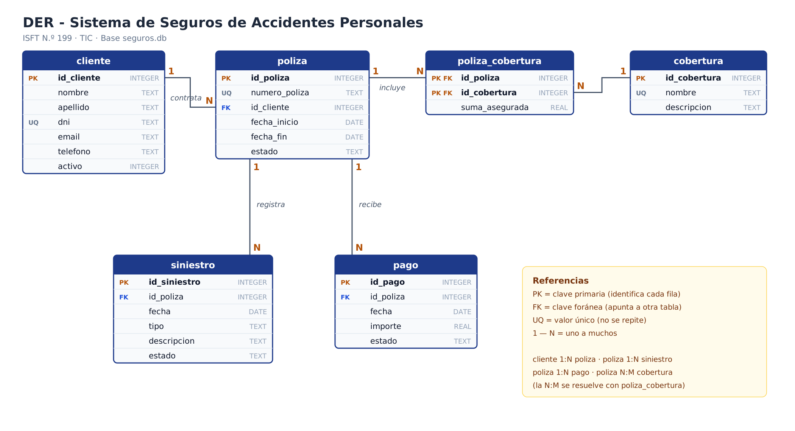

# Documento explicativo
## Sistema Web de Seguros de Accidentes Personales

**ISFT N.º 199** · Tecnicatura Superior en Ciencia de Datos e Inteligencia Artificial
**Materia:** TIC — Análisis de Datos y Explotación
**Alumna:** Iña
**URL pública:** _(completar)_ · **Repositorio:** _(completar)_
**Fecha de entrega:** _(completar)_

---

## 1. Descripción del sistema (Parte 1)

**Qué hace.** Es una aplicación web para que una compañía de seguros administre su cartera de seguros de accidentes personales: registra a los asegurados, las pólizas que contratan con sus coberturas, los pagos de las cuotas y los siniestros (accidentes) que denuncian. Además muestra un tablero con indicadores y gráficos calculados en el momento a partir de la base.

**Quién lo usa.** El personal administrativo de la aseguradora: quien da de alta clientes y emite pólizas, y quien recibe las denuncias de siniestros y actualiza su estado hasta cerrarlos. El dashboard lo usa también la supervisión para seguir la operación.

**Qué datos guarda.**
- **Clientes:** nombre, apellido, DNI (único), email, teléfono y si está activo.
- **Coberturas:** catálogo de lo que se puede cubrir (muerte accidental, invalidez, gastos médicos, etc.).
- **Pólizas:** número único, cliente titular, vigencia (inicio y fin) y estado (ACTIVA, VENCIDA, CANCELADA).
- **Póliza–Cobertura:** qué coberturas incluye cada póliza y con qué suma asegurada.
- **Pagos:** cuotas de cada póliza, con fecha, importe y estado (PAGADO, PENDIENTE, VENCIDO).
- **Siniestros:** accidente denunciado sobre una póliza, con fecha, tipo, descripción y estado (ABIERTO, CERRADO).

**Qué operaciones permite.** Alta, consulta, modificación y baja (CRUD) de clientes, pólizas y siniestros; búsqueda y filtros en cada pantalla; selección del cliente desde la base al emitir una póliza y de la póliza al registrar un siniestro; cierre y reapertura de siniestros.

**Qué información es útil analizar.** Cantidad de clientes y pólizas activas, siniestros abiertos frente a cerrados (carga de trabajo pendiente), distribución de pólizas por estado, qué tipos de accidentes son más frecuentes (para revisar coberturas y precios), evolución mensual de los siniestros (estacionalidad), recaudación y morosidad (pagos vencidos).

---

## 2. Modelo de datos (Parte 2)

| Relación | Cardinalidad | Cómo se implementa |
|---|---|---|
| cliente → poliza | 1 a N (un cliente puede tener varias pólizas) | FK `poliza.id_cliente` |
| poliza → siniestro | 1 a N | FK `siniestro.id_poliza` |
| poliza → pago | 1 a N | FK `pago.id_poliza` |
| poliza ↔ cobertura | N a M (una póliza tiene varias coberturas y una cobertura está en muchas pólizas) | Tabla intermedia `poliza_cobertura` con PK compuesta `(id_poliza, id_cobertura)` |

**Tabla agregada:** `poliza_cobertura`. La consigna pedía la tabla `cobertura` pero no decía cómo se relaciona con las pólizas. Como la relación es muchos a muchos, no se puede resolver con una sola FK: hace falta una tabla intermedia. Además ahí se guarda la **suma asegurada**, porque depende de la combinación póliza + cobertura (la misma cobertura puede valer $10 millones en una póliza y $25 millones en otra).

**Columna agregada:** `cliente.activo`, para poder dar de baja a un cliente sin borrar su historial.

**Restricciones usadas:**
- `PRIMARY KEY ... AUTOINCREMENT` en todas las tablas.
- `UNIQUE` en `cliente.dni`, `poliza.numero_poliza` y `cobertura.nombre`.
- `NOT NULL` en los datos obligatorios.
- `FOREIGN KEY` en todas las relaciones.
- `CHECK` para limitar los valores de los estados y tipos, que el importe y la suma asegurada sean mayores a 0, y que `fecha_fin > fecha_inicio`.

---

## 3. Normalización hasta 3FN

**1FN — valores atómicos, sin grupos repetidos.** Cada celda tiene un solo valor. En lugar de guardar en la póliza una columna `coberturas = "Muerte, Invalidez, Gastos médicos"` (una lista dentro de una celda) o columnas `cobertura1, cobertura2, cobertura3`, cada cobertura de cada póliza es una fila en `poliza_cobertura`. Lo mismo con pagos y siniestros: no hay `pago_enero, pago_febrero…`, cada pago es una fila.

**2FN — todo depende de la clave completa.** Solo importa en tablas con clave compuesta: `poliza_cobertura (id_poliza, id_cobertura)`. Su único atributo, `suma_asegurada`, depende de las dos partes juntas. El nombre y la descripción de la cobertura dependen solo de `id_cobertura`, por eso **no** se repiten en `poliza_cobertura` sino que están en `cobertura`.

**3FN — sin dependencias transitivas.** Ningún dato depende de otro campo que no sea la clave.
- `poliza` guarda solo `id_cliente`, no el nombre, DNI ni teléfono del cliente. Si estuvieran ahí, dependerían de `id_cliente` y no de `id_poliza` (dependencia transitiva), y al cambiar el teléfono de un cliente habría que actualizarlo en todas sus pólizas.
- `siniestro` y `pago` guardan solo `id_poliza`, **no** `id_cliente`. El cliente se obtiene a través de la póliza con un JOIN. Si se guardara también `id_cliente`, podría quedar inconsistente (un siniestro apuntando a una póliza de un cliente y a otro cliente distinto).

**Redundancias evitadas:** datos del cliente repetidos en cada póliza, siniestro y pago; nombre y descripción de la cobertura repetidos en cada póliza; listas de coberturas en una sola celda.

**Decisión consciente:** `tipo` de siniestro y los `estado` se guardan como texto controlado con `CHECK` en lugar de tablas aparte. Son listas cortas y fijas, el `CHECK` evita errores de tipeo y no hay atributos que dependan de ellos, así que no generan dependencias transitivas.

---

## 4. Base SQLite y consultas (Partes 3, 4 y 5)

- `sql/01_crear_tablas.sql` crea las 6 tablas con PK, FK, UNIQUE, NOT NULL y CHECK, y los índices sobre las FK.
- `sql/02_cargar_datos.sql` carga 12 clientes, 6 coberturas, 12 pólizas, 28 filas de póliza–cobertura, 20 pagos y 12 siniestros. Los datos se revisaron con consultas: todos los siniestros y pagos caen dentro de la vigencia de su póliza, y las pólizas vencidas tienen fecha de fin anterior a hoy.
- `sql/03_consultas.sql` tiene las 8 consultas obligatorias, los 3 JOIN pedidos (cliente+póliza, póliza+siniestro, cliente+póliza+siniestro) y consultas extra: LEFT JOIN de clientes sin pólizas, coberturas por póliza, total cobrado por cliente y pagos vencidos.

Resultados con los datos de prueba: 12 clientes, 8 pólizas activas, 12 siniestros (5 abiertos y 7 cerrados), promedio de pagos $12.625 ($13.486,67 si se toman solo los cobrados).

---

## 5. Aplicación web (Partes 6 y 7)

**Arquitectura.** Next.js reúne el front-end (las pantallas, en `app/*/page.js`) y el back-end (la API, en `app/api/*/route.js`) en un solo proyecto. Las pantallas nunca tocan la base directamente: llaman a la API con `fetch`, y la API ejecuta el SQL con `@libsql/client`. Esa librería habla igual con el archivo `seguros.db` y con Turso, así que el código es el mismo en la compu y en Vercel; solo cambian las variables de entorno.

**Menú:** INICIO / DASHBOARD · CLIENTES · PÓLIZAS · SINIESTROS.

**Clientes.** Lista con búsqueda por apellido, nombre o DNI. Formulario con Nombre, Apellido, DNI, Email y Teléfono; GUARDAR ejecuta un `INSERT` real. Ver muestra los datos y sus pólizas. Editar ejecuta `UPDATE`. Eliminar: si el cliente no tiene pólizas se borra (`DELETE`); si tiene, se da de baja (`UPDATE activo = 0`) para no perder el historial, y se puede reactivar.

**Pólizas.** Muestra número, cliente, inicio, vencimiento y estado. El cliente se elige de un desplegable cargado desde la base. Se eligen las coberturas con su suma asegurada; la póliza y sus coberturas se guardan en una **transacción** (o se guarda todo o nada). Si el número queda vacío se genera automáticamente. Eliminar: si tiene siniestros o pagos se cancela (`UPDATE estado = 'CANCELADA'`); si no, se borra.

**Siniestros.** Se registra eligiendo una póliza activa. Campos: póliza, fecha, tipo, descripción y estado. Se valida que la fecha esté dentro de la vigencia de la póliza. Botón "Cerrar siniestro" para pasar de ABIERTO a CERRADO; también se puede editar, reabrir o eliminar.

**Validaciones.** Se validan en el formulario (para avisar rápido) y otra vez en la API (porque alguien podría llamar a la API salteando el formulario). Los valores siempre se pasan como parámetros `?` y nunca pegados en el texto del SQL, lo que evita la inyección SQL.

---

## 6. Dashboard y explotación (Parte 8)

Todos los valores salen de `GET /api/dashboard`, que ejecuta las consultas en el momento; no hay ningún número escrito en el código.

**Indicadores:** clientes activos, pólizas activas, siniestros abiertos, siniestros cerrados, total cobrado y pagos vencidos.

**Gráficos (Chart.js):**
1. **Pólizas por estado** — `GROUP BY estado` sobre `poliza`.
2. **Siniestros por tipo** — `GROUP BY tipo` sobre `siniestro`.
3. **Siniestros por mes** — `GROUP BY strftime('%Y-%m', fecha)`. Los meses sin siniestros se completan con 0 para no saltear meses en el gráfico.

Cada gráfico tiene un desplegable "Ver consulta SQL" con la consulta que lo alimenta.

**Lectura de los datos de prueba:** la mayoría de las pólizas están activas (8 de 12). Caídas y accidentes de tránsito son los tipos más frecuentes (3 cada uno). Hay 5 siniestros abiertos, todos de junio en adelante: los más viejos ya se resolvieron, lo que indica que la gestión avanza en orden. Hay 3 cuotas vencidas para seguir con cobranzas.

---

## 7. Publicación (Parte 9)

- Código en GitHub: repositorio `tic-seguros-ina`.
- Base publicada en Turso (libSQL), cargada con los mismos scripts SQL que `seguros.db` (`npm run db:init`).
- App publicada en Vercel, conectada al repositorio, con las variables `TURSO_DATABASE_URL` y `TURSO_AUTH_TOKEN`.

---

## 8. Recorrido de la demostración (Parte 10)

| Paso | Dónde | Qué pasa en la base |
|---|---|---|
| Crear un cliente | Clientes → + Nuevo cliente → GUARDAR | `INSERT INTO cliente` |
| Mostrar que quedó registrado | Buscar por apellido / botón Ver | `SELECT … WHERE apellido LIKE ?` |
| Crear una póliza para ese cliente | Pólizas → + Nueva póliza → elegir el cliente | `INSERT INTO poliza` + `INSERT INTO poliza_cobertura` |
| Registrar un siniestro | Siniestros → + Registrar siniestro → elegir la póliza | `INSERT INTO siniestro` (estado ABIERTO) |
| Cambiar ABIERTO → CERRADO | Botón "Cerrar siniestro" | `UPDATE siniestro SET estado = 'CERRADO'` |
| Ver el Dashboard | Inicio / Dashboard | Clientes +1, pólizas activas +1, siniestros cerrados +1 |
